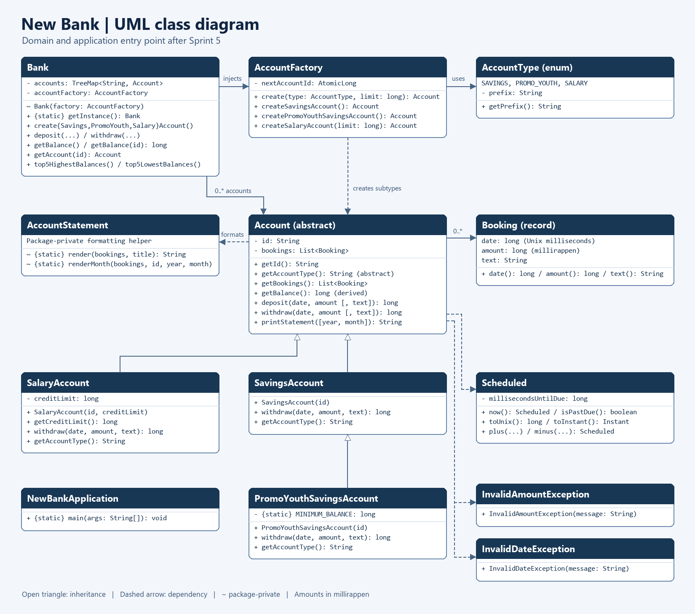

# Architecture after Sprint 5

`Bank` keeps the account registry and delegates account creation to an injected `AccountFactory`.
The factory chooses a subtype using `AccountType` and uses an atomic counter shared by the types
within that factory. `Bank` uses only `Account` when managing accounts and producing rankings.
`Account` validates transactions and holds the booking history; subtypes add withdrawal rules.
`AccountStatement` handles statement filtering and formatting.

## Sprint 5: shared bank and test isolation

| Variant | Lazy? | Safe initialization? | Cost per access |
| --- | --- | --- | --- |
| Eager static final | No, created during Bank initialization | Yes | Read a static field |
| Synchronized lazy accessor | Yes | Yes | Enter a synchronized method |
| Initialization-on-demand holder | Yes | Yes | Read a static field after holder initialization |

We chose the holder: the JVM initializes it once, on first access, without synchronization on
every call. Double-checked locking without `volatile` does not safely publish the constructed
object to callers that read the reference outside the lock.

A shared bank gives the application one registry and ID sequence. Global access hides dependencies
and shares mutable state between callers. It also ties the standard instance to the classloader
lifetime and cannot make separately running processes share a bank. Thread-safe initialization
does not make the registry or its transactions safe for concurrent writes.

In the strict singleton experiment, two tests both expected an empty bank; the second saw the
first test's deposit. A reset before each test cleared the registry and recreated the factory.
That was a temporary workaround: a concurrent test could lose its data during another test's
reset. The final constructor is package-private and accepts the factory. Tests instantiate fresh
banks; only callers choosing the shared entry point use `Bank.getInstance()`. The two singleton
tests check identity and absence of public constructors.

## Scope

The model is in memory. The Spring Boot entry point exposes a health check; banking controllers
and persistent customer data are not implemented. `Scheduled` represents a relative offset
resolved at conversion time, not a fixed deadline or a job queue.
